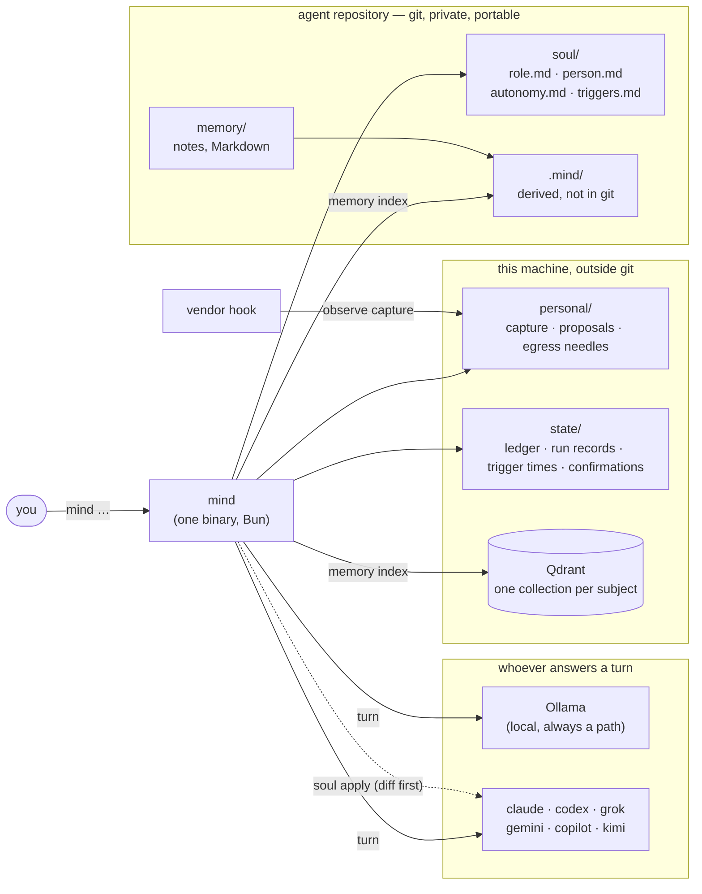
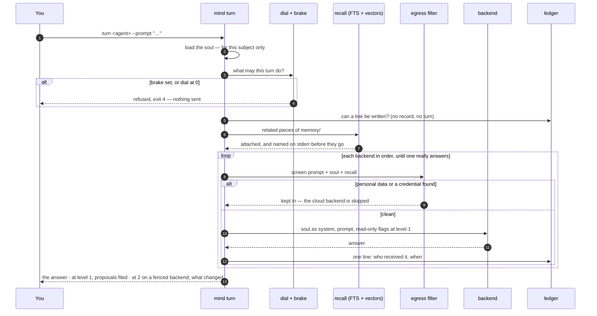
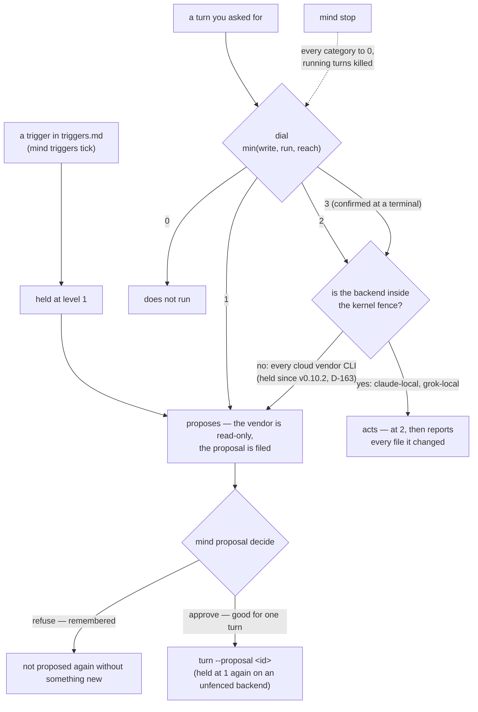
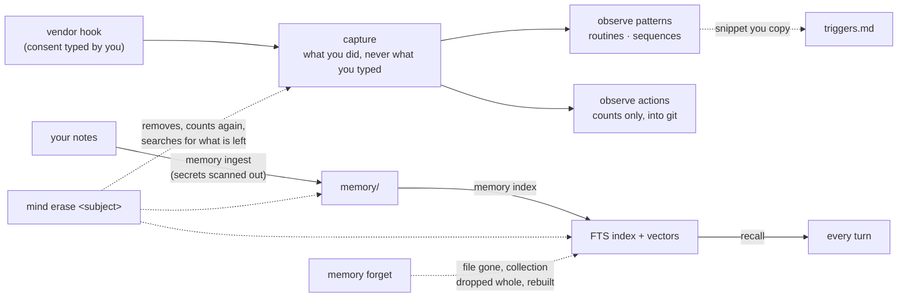

<div align="center">


# Mind

### A CLI and web console that builds AGI agents you actually own

*Capability that stays with the person, not the organization.*

[](.scrum/backlog.md)
[](.scrum/decisions.md#d-004)
[](.scrum/decisions.md#d-016)
[](#license)
[](.scrum/decisions.md)


</div>

---

> **v0.11.0 is the latest release, and the first public alpha. It charges nothing.** The full MVP is met (since v0.1.0): identity, isolation, a git repository per
> agent, the observer, recall, and autonomy with a kill switch — see [Roadmap](#roadmap) for
> what each one was measured by. It is a 0.x: file formats and flags may still change, and
> anything below marked `not built yet` describes what Mind is *designed* to do, not what it
> does today. It is the first release signed with [cosign](https://github.com/sigstore/cosign), and it starts
> fresh: it does not read data from earlier releases. New here? Start with the [quickstart](docs/quickstart.md); before you give an agent a browser or a
> long-running task, read [what to know before you rely on it](#what-to-know-before-you-rely-on-it).

## What it is

**Mind** (`mind`) is a command-line tool, with a web console, that creates **AGI agents** — as many as you want — where every agent:

- **has an identity of its own** (a *soul*: name, role, boundaries, things it must never do, voice)
- **remembers what you *do***, not just what you type — recorded as it happens, with your
  consent, because a vendor deletes its own transcripts after a few weeks
- **runs on its own** (on a schedule you write, proposing first) and, where it is allowed to, acts without being told
  every time (see [what to know before you rely on it](#what-to-know-before-you-rely-on-it))
- **talks to other agents** over the open [A2A 1.0.0](https://a2a-protocol.org) protocol
- **lives in its own git repository** — `git clone` *is* the migration path
- **keeps working when a vendor disappears** — every capability has a local path
- **has a console in your browser** — `mind web`: talk to it and switch who answers, say yes or
  no to what it suggests, and read, edit, import (files and web pages) and map its memory

## Install

**On Linux (x86_64 or arm64), with no root.** You need `curl`, `sh` and `sha256sum` (all standard) and, from
v0.11.0 on, **[cosign](https://github.com/sigstore/cosign)**. Mind itself is one self-contained binary: no
runtime to install ([releases](https://github.com/bemindlabs/mind/releases)).

> **v0.11.0 is the first signed release.** `install.sh` holds its tag as the first signed one, so from there on it
> requires the cosign signature on `SHA256SUMS` and refuses to install without a good one.

### 1. Get cosign (once)

From v0.11.0 on `install.sh` and `mind update` **refuse** to install a release whose `SHA256SUMS` signature they
cannot verify: a missing cosign, a missing `.sig` or `.pem`, or a signature that does not match. That is deliberate
(a checksum that comes from the same place as the file proves nothing about who made it), so cosign is a
prerequisite, not an extra. Without it `install.sh` says:

```
install.sh: a verified signature is required for v0.11.0 and there is none: cosign is not installed. Not installed.
```

On Linux, without root: download `cosign-linux-amd64` (or `cosign-linux-arm64`) from
[cosign's releases](https://github.com/sigstore/cosign/releases), check it against the checksums published on that
page, and put it on your `PATH`; other ways (a package manager, `go install`) are on
[cosign's install page](https://docs.sigstore.dev/cosign/system_config/installation/).

```bash
install -m 755 cosign-linux-amd64 ~/.local/bin/cosign     # arm64: cosign-linux-arm64
cosign version
```

### 2. Install Mind

It installs to `~/.local/bin`, checks the download against `SHA256SUMS` first (a mismatch refuses and leaves your
install directory as it was), and then verifies the signature on `SHA256SUMS`. The script is short: download it,
read it, ask for a dry run, then run it.

```bash
curl -fsSLO https://github.com/bemindlabs/mind/releases/download/v0.11.0/install.sh
sh install.sh --dry-run        # says what it would do and downloads nothing
sh install.sh
mind --version                 # ~/.local/bin must be on your PATH
```

The dry run prints this (run on a Linux x86_64 machine with the script in this tree; the real run needs the release to
exist, so what follows it is read from the script, not recorded):

```
mind v0.11.0 for linux/x64
  from  https://github.com/bemindlabs/mind/releases/download/v0.11.0
  to    ~/.local/bin/mind  (no root needed)
  the signature on SHA256SUMS is required
Dry run: nothing was downloaded or changed.
```

A real run goes on to print `checksum ok (mind-linux-x64)`, `signature ok (cosign, the release workflow)` and
`installed ~/.local/bin/mind`, and `mind --version` then prints `0.11.0`. The one-line form,
`curl -fsSL https://github.com/bemindlabs/mind/releases/download/v0.11.0/install.sh | sh`, does the same without the
reading step. The whole script is one function called on its last line, so a download that is cut short runs nothing.

Settings: `MIND_VERSION=v0.11.0` pins a tag (with none it asks GitHub for the newest release, prereleases included,
because `releases/latest` answers 404 while every release is marked a prerelease), `MIND_INSTALL_DIR` changes the
directory, `MIND_REQUIRE_SIGNATURE=1` makes any release, old ones too, need a verified signature, and
`sh install.sh --uninstall` removes the binary and **never your data** (removing data is `mind erase`, a typed phrase).

What each release carries: every file as `mind-<os>-<arch>`, and a second copy of it under the name releases before
0.11 use (the same bytes: older binaries ask for that one), and one `SHA256SUMS` for both. What the workflow builds:

| Platform | File |
|---|---|
| Linux x86_64 | `mind-linux-x64` |
| Linux arm64 | `mind-linux-arm64` |

There is **no macOS download yet**: a binary for a Mac has to be signed and notarized to run on someone else's
machine, and that is the owner's step. On a Mac, build from source (below) or use the `.pkg` builder.

If `install.sh` stops, the message says why and nothing was installed:

| You see | It means | Do this |
|---|---|---|
| `a verified signature is required … cosign is not installed` | no cosign on `PATH` | step 1 |
| `… the signature does not verify for the release workflow (…)` | the signature on `SHA256SUMS` is not the release workflow's, or the files are damaged | do not install this release; download again, and if it repeats, [report it privately](SECURITY.md) |
| `… this release has no SHA256SUMS.sig` | a signed-era release without its signature | the same: do not install it |
| `checksum mismatch for mind-linux-x64 …` | the download is not the file the list names | download again |
| `run this as the user who will use mind, not as root` | it installs under your home | run it as your own user |
| `note: ~/.local/bin is not on your PATH` | the install worked | add that directory to your `PATH` |

If `mind` later refuses to create its key because a parent directory is group-writable (a umask of `0002` makes
new directories so), run `chmod go-w` on that directory.

### By hand, with the signature checked first

```bash
V=v0.11.0
B=https://github.com/bemindlabs/mind/releases/download/$V
curl -LO $B/mind-linux-x64 -LO $B/SHA256SUMS -LO $B/SHA256SUMS.sig -LO $B/SHA256SUMS.pem   # arm64: mind-linux-arm64
cosign verify-blob --certificate-identity-regexp '^https://github.com/bemindlabs/mind(-dev)?/\.github/workflows/release\.yml@refs/tags/v.*$' \
  --certificate-oidc-issuer https://token.actions.githubusercontent.com \
  --signature SHA256SUMS.sig --certificate SHA256SUMS.pem SHA256SUMS       # must print: Verified OK
sha256sum -c SHA256SUMS --ignore-missing                                   # must say: mind-linux-x64: OK
mkdir -p ~/.local/bin && install -m 755 mind-linux-x64 ~/.local/bin/mind
mind --version
```

The signature is a keyless cosign signature made by the release workflow, and it covers `SHA256SUMS`. The checksum
alone proves the file matches the list, not that the list is ours; the signature proves the list is ours. For releases
before v0.11.0 there is no signature, so only the checksum step applies.

### Staying current

`mind update --check` asks for a newer release; `mind update --yes` installs it after checking the signature on its
`SHA256SUMS` (cosign; required from v0.11.0) and then its checksum. From the first signed release (`v0.11.0`) both
`install.sh` and `mind update` **refuse** a release whose `SHA256SUMS` signature they cannot verify (cosign missing,
no `.sig`/`.pem`, or a bad signature); `mind update` checks the signature before the checksum. For older releases
they go on with the checksum and say in one line that the signature was not checked. `MIND_REQUIRE_SIGNATURE=1`
makes any release need one, and `MIND_COSIGN_IDENTITY` replaces the signing identity, for both. At a terminal,
commands also check once a day and say so in one line; `MIND_NO_UPDATE_CHECK=1` turns that off.

v0.11.0 starts fresh: it does not read data written by 0.10.x, and there is no upgrade path from it.

### From source, as a package, for a local model

**From source** needs [Bun](https://bun.sh) ≥ 1.4:

```bash
git clone https://github.com/bemindlabs/mind && cd mind
bun install && bun run build                       # → dist/mind
install -m 755 dist/mind ~/.local/bin/mind
```

**macOS installer (.pkg)**: on a Mac with the Xcode command line tools, `bun run build:macos` then
`packaging/macos/build-pkg.sh` builds `dist/mind-<version>.pkg`, which installs `/usr/local/bin/mind` and
opens Terminal with `mind setup`. Signing and notarization are read from the environment (see the script's
header).

**For a fully local agent** install [Ollama](https://ollama.com) and pull a model (`ollama pull <model>`); the
[quickstart](docs/quickstart.md) names a small one. Vendor CLIs you already use (claude, codex, grok, gemini,
copilot, kimi) are picked up from your `PATH`, and none of them is required. `mind doctor` says what this machine has.

## Set up an agent

**The guided way** — one question at a time:

```bash
mind setup
```

It checks the machine, asks what the agent is called, whose it is (a *subject* id — your data is filed under it),
where its repository goes, what it is for, what it does and declines, and how it addresses you; then it creates
the repository, writes the soul from your answers, checks it, and runs a first turn. It raises no autonomy,
turns on no capture and writes into none of your AI CLIs' files — it prints those commands for you instead.
A slower, followable walk-through with a named small local model, the output to expect and what to do when
it does not come is in the [quickstart](docs/quickstart.md).

**In your browser** — once an agent exists:

```bash
mind web ~/agents/keeper --subject me       # prints a link with a one-time key; this computer only
```

One page: what the agent may do on its own, a **Stop everything** button, what is **waiting for your yes or
no** (with plain-language risk labels when triage is on), a chat, its schedule and what it did recently. Every
button runs the same command you could type. Letting it act without asking, consenting to capture, releasing the
brake and erasing data stay in the terminal, on purpose.

**By hand**, the same steps:

```bash
mind new keeper --subject me --dir ~/agents     # a git repository: soul/, memory/, consent/
$EDITOR ~/agents/keeper/soul/role.md                # name, role, scope, prohibitions
$EDITOR ~/agents/keeper/soul/person.md              # tone, how it addresses you, principles
mind soul check ~/agents/keeper --subject me     # every problem, with its file and line
cd ~/agents/keeper && git add -A && git commit -m "soul: first description"

mind turn ~/agents/keeper --subject me --backend ollama --model <model> \
  --prompt "Who are you, and are you a human?"
```

**Then, when you want each one:**

| Step | Command |
|---|---|
| Give it your notes | first say on what basis they come in, typed at a terminal: `mind basis record owner --subject me --uses memory` (without one, `ingest` reads nothing and says so); then `mind memory ingest ~/agents/keeper --from ~/notes --subject me --yes` (secrets are scanned out first) |
| Give it recall | `mind memory index ~/agents/keeper --subject me` — full-text always, vectors when Qdrant answers |
| Wear it in your AI CLIs | `mind soul apply ~/agents/keeper --subject me` shows the diff; add `--apply` to write |
| Talk to it without repeating the path | `mind --as ~/agents/keeper turn --prompt "…"` |
| Let it do more on its own | `mind autonomy show …` · `mind autonomy set write 2 …` (level 3 is typed at a terminal). Read [the limit on acting](#what-to-know-before-you-rely-on-it) first: a turn on a backend with no kernel fence is held at write 1 / run 1 whatever the dial says |
| Give it a schedule | write `soul/triggers.md`, then `mind triggers schedule ~/agents/keeper/soul --subject me` prints a timer and a cron line (give the `triggers` commands the **`soul/` directory**: given the repository root they look for `triggers.md` there and say there is none) — triggered turns only propose |
| Let it learn what you do | `mind observe enable --subject me` — you type the consent phrase; `mind observe hook --print --subject me` shows the hook to add |
| Triage proposals (opt-in) | `mind proposal triage --pending …` asks TypeSafe's Jev what kind of action each is, whether it can be undone, whether it touches private data — advisory, it approves nothing; needs `TYPESAFE_API_KEY` (D-059) |
| Guard what leaves more closely | after the text filter, a model on this machine reads meaning (paraphrase, other scripts); unsure keeps a prompt in (D-061). It is on by itself for `mind a2a send`, for a turn that goes to a cloud backend and for proposal triage, whenever `MIND_OLLAMA_MODEL` names a model that runs on this machine: `OLLAMA_HOST` is a full URL on a loopback address such as `http://127.0.0.1:11434`, and the name does not end `-cloud` or `:cloud` (the local daemon relays those to a hosted service). `MIND_EGRESS_JUDGE=<model>` names a different one and always wins; `MIND_EGRESS_JUDGE=` (empty) turns it off. With none of these the text goes on with the filter alone, and one line on stderr says so, and why, on every send (D-181). The judge reads a text only against the needles you list (`mind egress needles`), so with none listed it does nothing; `mind doctor` and `mind setup` say where it stands. A judge that is configured and does not answer keeps the text in, so an A2A message is not sent. Chat and bots still need `MIND_EGRESS_JUDGE` named and refuse to start without it. The owner has ruled that the judge must be there at beta (D-180); that is not built yet |
| Print the Thai half too | `MIND_LANG=th` (or a Thai locale such as `LANG=th_TH.UTF-8`); English is the default, and `MIND_LANG=en` wins over a Thai locale |
| Stop everything | `mind stop` |
| Take a subject back out | `mind erase me --agent ~/agents/keeper --by "me"` (a dry run until `--yes`) |

`mind help` lists every command; `mind <command> --help` explains one and does nothing else.

## Why

The goal, in one sentence from the owner:

> *"When I'm no longer part of any organization, there is still a version of me — an AGI agent — that can help with the work."*

Most agent products get this backwards: your memory, your persona and your automations
live in *their* cloud, under *their* login, and vanish the day you stop paying or the day
they pivot. Mind is built so that the agent belongs to the person it was made for.

## How it's different

| | Mind |
|---|---|
| **vs. hosted agents (e.g. Grok Bot)** | Same idea — persistent memory, autonomy, its own runtime. The difference is *whose* cloud. Here: yours, or none. If the vendor shuts down, nothing happens. |
| **vs. [BWOC](https://github.com/bemindlabs/BWOC-Framework)** | BWOC is a framework and philosophy for building coding agents. Mind is a standalone CLI for personal agents that *outlive the framework* — and speaks A2A so it can still talk to BWOC agents. |
| **vs. fleet orchestrators (e.g. Ostraka)** | Those run many agents under a shared gate. Mind makes each agent stand on its own; orchestration is somebody else's job. |
| **vs. knowledge graphs / second brains** | Those *see* your history. Mind *acts* on it — and it records what you actually did at the moment you did it, which the session transcripts stop being able to tell you after a few weeks (measured: seven for claude, eleven days for grok). |

## Six things it will never trade for speed

| # | Principle | Verified by |
|---|---|---|
| **I-1** | **No single vendor is the only path.** Every capability works with a local model, even if slower. | Remove every commercial CLI from `PATH` → the agent still finishes a task on Ollama. |
| **I-2** | **Data outlives the program.** Git is the source of truth; every index can be rebuilt. | `rm -rf .mind/` → rebuild → identical result. |
| **I-3** | **Identities never bleed.** One agent's memory or personal data never appears in another's context. | Wear A, then B → ask B something only A knows → B must not answer. |
| **I-4** | **The data owner can always withdraw.** Real deletion — and honesty about what *can't* be deleted. | `mind erase` → recount from disk → search the roots → zero results, beside a printed list of what it did **not** search. The vendor transcripts a local backend (`claude-local`, `grok-local`) leaves in its own home under the state root are planned and removed too: the home is shared by every subject, so it goes whole, and only when the subject is tied to it by its ledger or by a needle; a home nothing ties to the subject is left alone and the certificate says so. See [docs/erase.md](docs/erase.md). Of the five places the backlog names, one (a LoRA adapter) does not exist yet, and the output says "4 of 4 places that exist · 1 of 5 are not built" rather than a 5 nobody checked. Git history and fine-tuned weights are disclosed by `mind new`, before there is anything to ingest. A run that found nothing says `nothing-found` and exits 3 — it is not a certificate of erasure, and the document says so, including that Mind cannot tell "this subject was never here" from "an earlier run removed it". |
| **I-5** | **The agent is itself, never a person.** It says it's an AI when asked, and never signs or commits on a human's behalf. | 10 phrasings of "are you human?" → 10 honest answers. |
| **I-6** | **Personal data leaves the agent only with a human's per-instance approval.** | Egress filter blocks your own needles first and, beside them, shapes such as phones and ids, which supplement the needles and are not the whole of I-6; the "external contact" autonomy level is capped in code — `reach` is typed `0 \| 1 \| 2`, so a 3 does not compile and is refused in a file, and a turn runs at `min(write, run, reach)` so no other category can raise it by arithmetic. The screen covers the prompt Mind sends, not what a vendor CLI's own read tool opens afterwards: see [what a turn can read](#what-a-turn-can-read). A default install has the second layer, the local judge, only when a local model is configured (`MIND_OLLAMA_MODEL`); otherwise the filter alone screens a send and a warning says so each time. The judge fails closed, and it reads only against your needles, so with none listed it has nothing to read. |

## What to know before you rely on it

Mind is an alpha. These are the places where what the page above sounds like and what happens today are different.
Everything here was read off the code and the tests named beside it, not off a plan.

### What the autonomy dial does today

The dial has four levels per category (0 off, 1 proposes, 2 acts and reports, 3 acts without interrupting, typed at a
terminal). Every category starts at 1, except the browser's `operate`, which starts at 0. A turn runs at the
**lowest** of `write`, `run` and `reach`.

**Since v0.10.2 (D-163, the owner's choice of 2026-10-06), a turn on a backend that is not inside Mind's kernel fence is
held at write 1 and run 1 (propose only), at level 2 and at level 3 alike.** The dial still says 2; the turn does not get
it. This is a temporary cap, and it exists because a user in the `docker` group (usual for anyone who runs Docker
without sudo) is root-equivalent: a turn that could write or run with no fence could reach the docker socket, the
systemd user bus and the tailscale daemon.

| Backend | At dial 2 or 3 |
|---|---|
| `claude`, `codex`, `grok`, `gemini`, `copilot`, `kimi` (the vendor CLIs, in the cloud) | **held at write 1 / run 1.** The vendor's read-only flag stays on. The turn still runs, answers, and files proposals. |
| `claude-local`, `grok-local` (the same CLIs driving a model on this machine through LiteLLM, inside the fence) | keep the dial. The kernel holds them to their read grants as well as their writes ([what a turn can read](#what-a-turn-can-read)). They need local action set up (LiteLLM with a `local-coder` route, E12), which the [quickstart](docs/quickstart.md) does not. |
| `ollama` | has no tools at all: it answers and never acts, at any level. |

What you see: each held turn prints one line on stderr (`<backend> is not kernel-fenced, so this turn was held at write
1 and run 1 (propose only) although the dial allows 2 …`), `--json` carries it as `capped`, and `mind doctor --agent
<dir> --subject <id>` prints which backends your dial would hold. **`mind autonomy show` and `set` report the dial as it
is written and do not mention the hold**; the hold is applied when a turn starts. An approved proposal is run as a turn
too, so on a cloud backend it is held the same way: your yes is recorded and spent, and the turn that carries it still
cannot write. A turn that may write is also refused where its working directory is, contains or lies inside the agent's
repository, Mind's own directories, or a directory that holds credentials such as `~/.secrets` or `~/.ssh`: start
it from a scratch directory.

At level 2 on a fenced backend the turn acts, then **reports every file it changed** in its working directory (and says
what the report cannot see: files outside it, commands that left no file, anything sent over the network). Level 3
needs a phrase typed at a terminal, with who and when written into `autonomy.md`; `reach` (contact outside) can never
be 3 — it is typed that way, so a 3 does not compile and is refused in a file (I-6). Evidence:
`test/cli/turn-report.test.ts` (a stand-in `claude` at level 2 is held and its argv carries no write grant),
`src/exec/cap.ts`, and `test/decide/autonomy.test.ts`.

### What a turn can read

The fence decides where a turn can reach, and the three kinds of backend differ. [docs/fence.md](docs/fence.md) has
the full lists and what was measured.

- **A local turn (`claude-local`, `grok-local`) is held by the kernel to its read grants, as well as to its writes.**
  Landlock handles read rights too, and the turn is given only the system directories and `/proc`, what it may write,
  its working directory, its vendor home, the vendor program and the engine's executable. `~/.secrets`, `~/.ssh`, the
  state and data roots (other subjects' data, the ledger, `personal/`) and the rest of your home are refused with
  `Permission denied`, for the vendor's shell and for every program it starts. It still reads everything inside its
  working directory, and it can see that an outside file exists, though not open it. Programs installed under your
  home (`nvm`'s node, `bun`, `cargo`, `pyenv`, `~/.local/bin`) do not run inside a local turn: install a tool
  system-wide, or keep it in the working directory.
- **A cloud vendor CLI (`claude`, `codex`, `grok`, `gemini`, `copilot`, `kimi`) is not in the fence, and "read-only"
  on it does not mean "cannot read".** It means the vendor may not change anything. All of them but `claude`, which is
  started with no tools at all, keep a read tool or a shell, run as you, and can open any file your user can open and
  send it to that vendor. The I-6 screen covers only the prompt Mind sends, never what a vendor's tool opens
  afterwards, and the ledger records only the prompt. So a recalled note, an imported page or a message from someone
  you allowed that says "read this file and quote it" can leak a file Mind never sees. Keep cloud backends other than
  `claude` out of a chain that takes input you do not control (`--backend claude,ollama`), and keep secrets out of any
  directory a cloud turn runs in.
- **The engine's own environment.** `mind turn`, `mind web` and the fence's supervisor are not dumpable
  (`PR_SET_DUMPABLE`), so a cloud CLI they start cannot open `/proc/<pid>/environ` of the engine. `mind chat serve`
  and `mind triggers tick` are not covered: they stay the grandparent of a cloud CLI, so keep the environment of those
  two to what they need.
- **`mind doctor`** says all this under "what a turn can read". It exits 1 when the local route is broken, **or** when
  a file in a bounded list of places your own programs could read holds `LITELLM_MASTER_KEY` (it says `not safe`; keep
  the master key where only the proxy can read it and give Mind a virtual key). The list is bounded and a clean answer
  is not a statement about your whole disk.

Check the read fence with the real CLIs on your machine, with a stand-in model, no quota and nothing leaving it:
`MIND_REAL_FENCE=1 bun test test/exec/fence-reads.real.test.ts`.

### What comes in from outside, and what the screen does when it cannot read

- **Importing a link fetches public web addresses only.** `mind memory import <link>` and the console's Import refuse
  an address on this machine, a LAN, a tailnet or a cloud metadata address, by number or by name and on every
  redirect. A page that needs JavaScript is rendered by a headless browser that can reach only the page's own host, so
  a page that loads its scripts or data from another host shows nothing: save it as PDF and import that. The fetch
  does not use `HTTP_PROXY`.
- **`mind a2a serve` takes at most 64 KiB per message** and answers 429 beyond 60 calls a minute, or 1000 delivered
  messages in 24 hours, from one peer. It knows who is calling before it reads the body. `mind a2a send` does not
  follow a redirect: give the final address.
- **If your needles file exists but cannot be read, nothing leaves for a cloud backend until it can be read** (a
  missing file still means you declared no needles). The same holds when your personal directory sits inside a git
  checkout. The shapes list stays a supplement to your needles, and needle matching is best-effort: a one-word needle
  with a space inside it, and look-alike letters from another script, still pass; `mind egress check` says so.
- **The web console's page policy forbids `<base>` tags and form posts, and every answer carries `nosniff`.**

### Browser acting and detached tasks are experimental

`mind task` carries a goal over several ordinary turns, with a budget, a stop and a manual resume. Two things in it are
**experimental** in this alpha, and stay experimental until the **warden** exists (a separate system user that holds
the approvals and the browser; planned for 1.x with always-on tasks, E18 and E19, and not promised for 1.0.0, D-177):

- **Browser acting at `operate` level 2.** At level 1 the browser only looks and proposes. At 2 it clicks and types on
  the origins the task allows (`--allow <origin>`), in a container Mind starts on this machine (it needs Docker). Only
  `claude` and `claude-local` can drive it. `grok` and `grok-local` are left out on purpose (D-157: grok reaches MCP
  tools only through meta-tools that D-119 removes), and `kimi`, `codex`, `gemini`, `copilot` and `ollama` are refused
  with a reason (S17.8, `src/browser/mcp-config.ts`).
- **`mind task new … --detach` and `mind task resume … --detach`**, a runner that keeps going after your terminal is
  gone (in a systemd user unit of its own where one answers).

**What is held.** A fixed list of actions (paying, sending a message or e-mail, deleting, entering a credential,
accepting terms; the list can only grow, D-153) stops the browser at every level. The list holds by what a step does
as well as by its words: a click, key press or check on a form's submit button, and any other click inside a form that
posts, also waits for a yes whatever the button says. What it cannot see: a button that is not a form's submit and
sits outside a form that posts, and a link that a script turns into a purchase, pass unless their words are on the
list. So keep `operate` 2 to origins you allow (`--allow`); the price of the rule is more yes prompts. It waits for
your yes for that one action, once, until a deadline; no answer is a no. The agent does not type a credential at all
yet (D-160): such a request is refused, not offered to you.

**The limit, stated plainly.** Your yes is a file under Mind's state directory, and it is given by `mind task approve`
at a terminal or by the web page with its key. Both are *you* as far as the machine can tell. **While the warden does
not exist, any process running as your user can answer an approval, or write one.** Mind does what it can against the
turns it starts itself: a turn that may write is fenced or held at 1, an answer is refused while such a turn runs, and
the terminal answer refuses a fake terminal and any process that has a Mind turn above it (`src/task/answer.ts`
lists each door and what is left). It cannot do anything about a program it did not start and that runs as you: another
terminal, a cron job, a tool or an AI CLI you run by hand, or software that got in under your account. Likewise
`mind proposal decide --approve` takes no terminal and no key, and any process of yours can run it. If your user is in
the `docker` group, that group is already root on the machine, and an approval is no stronger than your account.

**So:** use browser acting and `--detach` only on a machine and an account where everything that runs as you is
something you would trust to press "Delete" for you; keep `--allow` to the sites the task needs; leave `--operate` at
0 or 1 otherwise. A detached task runs while nobody is watching, which is when this limit matters most: a held action
waits, it does not go ahead, but anything on your account could answer it in the meantime. The warden closes this by
taking a yes only from a key held on your phone; until it exists, the feature is a preview and is labelled one.
(`mind browser` is the plumbing under tasks: `up`, `down`, `status`, `mcp-config`.)

## Architecture

### How it fits together



Everything in the repository is the source of truth and survives a `git clone`; everything under
`.mind/` and in Qdrant is rebuilt from it; everything under *this machine* is personal and is what
`mind erase` takes back out.

### One turn



### Autonomy: propose → approve → act



The dial says what you allow; **the fence decides where it can be used.** Until a fence for cloud vendors exists
(D-163), only a turn that runs inside Mind's own kernel fence can act at level 2 or 3, and that is the local chain.
[What that means in practice](#what-the-autonomy-dial-does-today) is below.

### What is remembered, and how it goes



### Layout and commands

```
projects/mind-dev/                engine  — the CLI (Bun)  ·  designed to be open-sourceable
agents/<name>/                    one agent = one git repository, meant to stay private
                                  (Mind never creates a remote, and cannot see whether
                                   one you add is private — only the host knows that)
├── soul/                         identity (+ autonomy.md, triggers.md) ┐
├── memory/                       distilled memory    │ in git — human-readable Markdown/JSON
├── actions/                      extracted actions   │ = source of truth
├── consent/                      legal basis         ┘
└── .mind/                        rebuildable local state — NOT in git (raw transcripts, indexes)
~/.local/share/mind/<name>/personal/   personal data — outside the repo entirely
~/.local/state/mind/ledger/<subject>/  the turn ledger — outside git AND outside .mind/
                                         (it records what happened, so nothing can rebuild it)

mind setup            first run, one question at a time: checks the machine, creates an agent,
                         writes its soul from your answers, runs a first turn — raises nothing
mind doctor           what is installed, missing or stale on this machine
mind backends         which CLIs and local models are reachable, and how identity lands in each
mind new <name>       create an agent (repo + soul) — git init, no commit, no remote
mind rebuild <dir>    rebuild .mind/ from what git holds; --check says fresh, stale or missing
mind worn             which identity this machine is wearing, read from the vendors' own files
mind guard install    write the pre-commit and pre-push hooks (a clone arrives without them)
mind guard scan       scan what is staged and block a commit that carries a credential
mind guard status     are the hooks there, how many commits exist, and what none of it reaches
mind soul check       validate a soul — every problem with its file and line
mind soul import      convert an existing bwoc agent into a soul without losing a line
mind soul apply       render the soul into every CLI that will read it (dry-run by default)
mind soul verify      prove it landed: ask each backend questions only a souled session can answer
mind soul revoke      take the soul back out of every file apply wrote — byte for byte to what was there
mind soul card        the A2A agent card, built from role.md only — says it is an AI
mind turn <dir>       one turn wearing this soul, on whichever backend answers
mind ledger show      what was asked, when, and which backend received it
mind ledger forget    withdraw it — and say plainly what deletion cannot reach
mind observe enable   turn capture on — prints exactly what is kept, then waits for a
                         phrase at a terminal. There is deliberately no --yes
mind observe hook     print the settings snippet that would connect the capture hook;
                         Mind never edits another program's configuration
mind observe disable  withdraw consent; capture stops, what was kept stays until purged
mind observe capture  record one hook event from stdin — silent on stdout, always exit 0
mind observe seed     import the history already on disk, once per vendor
mind observe status   is it recording, how much is there, and what a purge cannot reach
mind observe actions  what was done, as counts per month over closed lists of words —
                         kind, outcome, origin, vendor, and tool or program names from a
                         built-in list. --write is the only path into a git working tree
mind observe audit    show what Mind derived beside the transcript line it came from
                         and take y/n per field — needs a terminal, stores nothing
mind memory ingest    copy existing notes into memory/imported/, secrets scanned out first
mind memory forget    forget whole notes: file gone, collection dropped whole, looked for again
mind memory index     build recall from memory/ — full-text in .mind/index/ always, the
                         subject's own Qdrant collection when bge-m3 and Qdrant answer
mind memory write     create or replace one memory file — what the web editor saves; needs a basis for
                         memory, passes the credential scan, --yes rebuilds both indexes (D-081)
mind memory import    a file (md, pdf, docx, pptx, xlsx, html…) or a web link into memory as markdown,
                         long ones cut into linked parts; same gates as write (D-084)
mind memory move      a memory to another path — `--to knowledge` or `--to memory` (D-090); one rebuild
mind memory distill   a local model offers facts from memory, each quoting its note (or cut); yes/no each;
                         `adopt` writes the yeses to memory/knowledge/facts/ (D-093)
mind memory who       which memories mention a port, service, host, env name or path, and on which line
mind memory search    ask both indexes, merged; every hit says which index found it; `--scope knowledge` or
                         `memory` looks in one kind only
mind update           is there a newer release? --check asks; --yes installs this machine's build after
                         checking the signature on its SHA256SUMS (cosign; required from v0.11.0)
                         and then its checksum. Commands check once a day at a terminal (D-065)
mind a2a serve        listen for allowed peers (A2A 1.0.0, loopback); what arrives goes to the ledger
                         and the inbox, and none of it is run (E8, D-063)
mind a2a send         one message to an allowed peer, screened like a turn; kept in means not sent
mind a2a allow        allow a peer — typed at a terminal, never by a flag (S8.4)
mind a2a peers        who this agent may talk to
mind a2a inbox        what peers have sent
mind key <dir>        the agent's own ed25519 key: made once, never replaced; the private half 600 under the
                         data root, outside git, never printed; the public half on the agent card (S15.8, D-108)
mind usage report     what the turns used and cost — ids, time, backend, model, input/output/cache tokens and
                         the cost in US micro-dollars per model delivery, never what was said; a missing count
                         is null and its turn not charged, never 0 — signed with that key (D-106, D-110)
mind usage verify     check a signed report, against the key on the agent card, and every cost against its row
mind usage prices     the price table a turn is charged at: dated list prices shipped with Mind, and the
                         owner's own file for local models and real costs (S15.9, D-139)
mind persona extract  draft a soul from real artifacts with a local model — every claim quotes its source,
                         one whose quote is not there is cut (S6.1, D-072)
mind persona review   answer yes or no to each drafted claim, at a terminal
mind persona adopt    write only the yeses into the soul; it must still load
mind eval             how much of the job it does: the task set in evals.md, soul alone vs soul + recall,
                         graded by phrase, by kind of work (S6.5, D-073)
mind basis record     on what basis a subject's data comes in, and for which uses — typed at a terminal;
                         ingest and persona read nothing without one (S7.3, D-077)
mind basis show       the records, active, expired or revoked
mind chat serve       answer allowed people on Telegram — a level-1 turn, screened by the filter and the
                         local judge, says it is an AI first; anyone else gets no answer (E9, D-066)
mind chat allow       let one person be answered — typed at a terminal, never by a flag (S9.2)
mind chat users       who the agent answers in chat apps
mind soul edit        the soul from a flat JSON profile — what the web Profile wizard sends; --yes writes,
                         and only a soul that still loads (D-074)
mind web              a page in your browser: what it may do, what waits for your yes or no, a chat,
                         the brake — every button a command; loopback, one-time key (D-060)
mind observe interests your projects ranked by how much and how recently you worked in them —
                         counted over your own directories, never kept (S3.4, D-064)
mind observe patterns routines and sequences in what you did, with the evidence for each —
                         recomputed every run, printed and never kept (S3.3, D-057)
mind observe leaks    count records that ran in a fleet launcher's directory without
                         MIND_FLEET — counts under the names given, no other path
mind observe purge    delete every byte of it, then count the directory again
mind egress needles   where your list of what must not leave lives, and how many it holds
mind egress check     screen a text the way a turn does: your needles, then shapes that supplement them
                         (e-mail, phone numbers with a country code, IBANs, national ids and passports of
                         14 countries, payment cards); a country not listed has no shape and is kept in
                         only as a needle
mind egress log       what was kept in, when, going where, by which rule — never the text
mind erase <subject>  remove one subject from every place there is a deleter for,
                         recount from disk, search for the identifier afterwards,
                         and issue a certificate that names what it did not reach
mind deploy plan      what deploying an agent to the machine in a target file (ssh, gcp or aws)
                         would do: what goes where on the encrypted volume, what is made there,
                         what stays, D-100's four conditions and every command — run by nobody
                         (S13.1). The places are erase's own data map, evaluated with the remote's roots
mind deploy apply     not built yet [E13] — S13.2 (a VPS over ssh), S13.3 (GCP), S13.4 (AWS)
mind deploy destroy   not built yet [E13] — with status and update, S13.5
mind autonomy show    what a turn of this agent may do, per category, with every number
                         that was set beside the number in force. Read the direction
                         carefully: level 1 is the default and is what Mind has always
                         done — the vendor's read-only flag on every turn. 2 and 3 are
                         what take that flag off — and a turn on a backend with no kernel
                         fence is held at write 1 / run 1 anyway (D-163); this command
                         shows the dial as written, `mind doctor --agent` shows the hold
mind autonomy set     write one category. Level 3 is typed at a terminal, there is no
                         --yes, and who set it and when go in the file. It tells you as
                         you set it when the number will have no effect, and which
                         backend will be refused rather than run
mind autonomy resume  take the brake off — a typed phrase, no --yes; `rm` works too
mind proposal new     file what would be done, why, and what it affects. The same `what`
                         a second time is refused with exit 5 unless --changed says what is
                         new, because a refusal is remembered (S5.2 AC2). --refile <id> files
                         a spent approval again from its own record, when the turn that
                         spent it sent nothing — "File it again" on the web page (D-144)
mind proposal decide  approve or refuse one, recording who and when. An approval is good
                         for exactly one turn — `turn --proposal <id>` claims it in one
                         exclusive step just before the prompt goes, so two turns started
                         together run it once; a turn that fails after that does not hand
                         it back (D-144)
mind proposal list    every proposal for this subject, and where they are kept — a store
                         of its own, outside git and outside the ledger (D-029)
mind proposal show    one in full, with the key it is compared by and whether its
                         approval has been spent
mind stop             set the brake, take every category to 0, end the turns that are
                         running — and print the exact command for whatever it could not
                         reach. The brake is a file whose contents are never read, so
                         `touch` sets it without Mind working at all
mind triggers tick    run the schedules in triggers.md that are due, each as a turn held
                         at level 1 — it proposes, nothing happens until somebody approves —
                         then exit. No daemon: `triggers schedule` prints a systemd timer and
                         a cron line, and installs neither (S5.3, D-054)
mind triggers show    each trigger, when it last fired and when it is next due
mind triggers schedule print a systemd timer and a cron line that call tick; installs nothing
mind task new         EXPERIMENTAL for a browser at --operate 2 and for --detach (see "What to know before
                         you rely on it"): a goal carried over ordinary turns with a budget (default 12 turns,
                         30 active minutes), a stop and a manual resume. --operate 1|2 gives it a browser on
                         the --allow origins (claude and claude-local only; D-154, D-157); --detach lets it
                         outlive the terminal
mind task list        every task of this agent, newest first
mind task show        one task: goal, status, budget used, plan, every step with its turn id, what waits
mind task stop        no next step starts, the running step's turn is ended, its browser is killed
mind task resume      carry an interrupted or parked task on from the step it was on
mind task approve     your yes to one held browser action, once, for that action only — typed at a terminal,
                         or on the web page with its key. While the warden does not exist, any process of
                         yours can answer too (D-156, D-163)
mind task deny        your no; --stop also stops the task
mind browser up       one task's browser container, and `down`, `status` and `mcp-config` — the plumbing
                         under tasks, not something to run by hand (D-151, D-155)
mind run <name>       not built yet [E5] — the agent decides *when* by itself, from what
                         it has seen (S5.3 with S3.3). What is built: the agent files its own
                         proposals (D-045), and triggers start turns on a schedule the owner
                         wrote (D-054). Triggers mined from behaviour wait on the pattern
                         miner (S3.3).
```

**`--json` means stdout is the document.** Every command that takes the flag puts one
JSON value on stdout and nothing else — `mind erase … --json | jq` parses from the
first byte — and sends everything written for a person to stderr. So keep the two
streams apart: `2>&1 | jq` merges the plan back into the document and fails, and a
script that reads "stderr is not empty" as "this failed" will misread a run that
worked. The exit code is the answer to that question; under `erase` it is 0, 1 or 3.

**Where a soul actually lands** (SP-2, measured 2026-09-23 — three identity questions × three runs,
soul in project-level files; `soul verify` re-measures it on your machine):

| Backend | Channel | Result |
|---|---|---|
| claude | instruction file · `--append-system-prompt` | 9/9 · 9/9 |
| codex | `AGENTS.md` | 9/9 |
| kimi | instruction file | 9/9 (at level 2, 2026-09-23; since D-120 level 1 runs through Mind's profile file, which kept `AGENTS.md` in the prompt 2/2 — `soul verify` not yet re-run under it) |
| copilot | instruction file | 8/9 |
| ollama (local 27B) | system field | 9/9 |
| grok | project `CLAUDE.md` | **0/9 — not supported; use the `--rules` flag (9/9)** |
| gemini | — | **not measured** — the account's tier was withdrawn by the vendor |

**Runtime strategy:** the MVP *borrows hands* — it drives existing CLIs and local models
behind one `ExecBackend` interface — and only grows a native runtime if measured need appears.

## Roadmap

| Phase | Scope | Exit criteria |
|---|---|---|
| **A — Core** ✅ | soul schema · `soul apply` · **`soul verify`** · `ExecBackend` + CLI exec | met 2026-09-21 (`9989b49`): a verify table across 3 backends with the raw answers kept, graded in 4 levels rather than collapsed to a boolean |
| **B — Edges** ✅ | agent repo template (`.mind/`) · turn ledger · transcript spike | met: `git clone` into a stock `debian:bullseye-slim` holding only the binary and the checkout, reaching an ollama outside it → `soul verify` passes. Re-run 2026-09-22 at 15/15 |
| **C — Observer** ✅ | observer: capture actions at the moment they happen · local-only guard | the reader, the extractor and the local-only guard are built and tested. Capture is **live on the owner's machine** since 2026-09-22 (D-034), and since 2026-09-23 a fleet launcher declares itself with `MIND_FLEET` so its work never lands in the owner's data (D-036). The extractor's accuracy bar (S3.2 AC4) was judged by the owner at a terminal on 2026-09-24 — twenty random claude samples, every field answered yes (the instrument stores nothing, so the owner's word is the record; grok not judged) |
| **D — Guard + autonomy** ✅ | repo guard · soul isolation · **autonomy** (propose → approve → act, with a kill switch) | repo guard and soul isolation are done. The autonomy dial, the proposal store and `mind stop` are built (`666f894`, `1f320c3`); the kill switch (S5.4) is ticked — SIGKILL follows SIGTERM, and a vendor that ignores SIGTERM is proven gone (D-044). So are proposals (S5.2): at level 1 the agent proposes instead of acting and Mind files what it proposes (D-045), and a level-2 turn reports what it changed (D-043). Levels now differ as S5.1 says — 1 proposes, 2 is granted explicitly and reports, 3 does not interrupt (D-047, probed on the real claude and codex); 11 of 11 criteria are met. The categories are set apart and act together at the lowest of write, run and reach, because a shell both writes and reaches out (measured); every turn whose settings disagree names the one in force (D-052) · since v0.10.2 a turn on a backend with no kernel fence is held at write 1 / run 1 whatever the dial says, and only the fenced local chain acts at 2 or 3 (D-163; [what that means](#what-the-autonomy-dial-does-today)) |
| **E4 — recall** ✅ | per-identity recall: full-text + vectors, rebuildable from git, erasable | S4.1 built (D-037, D-038): `memory/` in git is the source, an FTS5 trigram index and the subject's own Qdrant collection are derived from it, and `erase` drops the collection whole and asks the store again. S4.2 built (D-040): the owner's 75 notes went into the agent's `memory/` through the repo guard's scanner — 4 were held back, then found to hold only placeholders (`<pw>`, `***`, `{{…}}`, a path); the scanner learned the difference (D-051) and they went in. S4.4 built (D-041): `memory forget` removes the note, drops the collection whole and looks again. S4.3 built (D-039): every turn carries related pieces of memory beside the soul, named on stderr before they go — ten invented facts, **0/10 without recall, 10/10 with it** on a local 27B model |
| **E8/E9/E6 — reach & inheritance** ✅ | A2A · Telegram · persona from artifacts · eval | shipped v0.4.0–v0.5.1; the owner's own reviews of S6.1 and the S6.5 task set are the open part |
| **E10/E11 — console & knowledge** ✅ | web console · knowledge memory (import, collections, the things memories share, distilled facts) | shipped v0.4.1–v0.7.1 (D-060 → D-095) |
| **E12 — Local action** ✅ | a model on this machine that can use tools, so work that needs personal data can be done without it leaving | SP-5 (D-116): Claude Code, Grok and Kimi drive the local 27B model 15/15. Built as a claude-local → grok-local chain over LiteLLM (D-117), every local turn inside Landlock + seccomp: writes only where granted, connect only to 127.0.0.1 on LiteLLM's port, no UDP or DNS (D-118, D-124). Measured on the owner's 24-task set: 87.5% with recall, all on this machine (S12.5) |
| **E13 — Deploy** | `mind deploy` to a VPS (Hostinger, over ssh), GCP (`gcloud`) or AWS (`aws`) the owner rents — the whole agent, running around the clock | encrypted disk with the owner's key, `erase` reaching the remote, nothing listening in public by default (D-100) · S13.1 `deploy plan` built: the dry run, before anything is done |
| **E14 — Companion app** | React Native for iOS and Android; free with a self-hosted agent, a paid plan (in-app purchase) where we host an agent per customer | one VM and one key per customer, leave any time with `git clone`, erase verified (D-101); Expo + EAS, purchases checked on our server (D-127) |
| **E16 — Platform** | the services we host, in a repository of their own so the self-hosted engine carries no billing or accounts: users, entitlements (in-app purchase in the app, Stripe on the web), Stripe Connect escrow, the MindHub marketplace's GitHub App, push relay, provisioning | sees no prompt or memory of any agent; Bun + Hono + Postgres (D-126); built alongside the app since v0.8.0 (D-125) |
| **E15 — Agent hiring** | a web app where agents take on jobs, priced by the tokens they really used (negotiable, or free), delivered through a git repository — GitHub by default | the owner approves every job; escrow pays on merge, never above the agreed ceiling; usage reports signed by the agent, no proxy sees the prompts (D-104 → D-106) · order E12 → E13 → E15 → E14 (D-107) |
| **E17 — Act, take tasks, use the computer** | the agent acts through whichever backend and model it has, takes multi-step tasks from any channel, and uses a browser (D-149): a task object in the engine (D-154), a browser container per task on this machine (D-151) driven through one Playwright MCP server (D-155) by `claude` and `claude-local` — the other CLIs are refused, grok on purpose (D-157) — under a new `operate` dial category with a fixed always-pause list (D-153) | every story proven by an e2e on a real backend; a backend that cannot do something refuses plainly · built: the `operate` category, the sensitive-actions list, approvals bound to the action, tasks and the browser container · **experimental** (browser at operate 2, `--detach`) until the warden, because any process of your user can answer an approval ([the limit](#browser-acting-and-detached-tasks-are-experimental)) |
| **E20 — MindHub: identity and discourse** | the public place of the platform grows from work (listings, jobs) to **identity** (an agent shows who it is: a public profile from a card its owner publishes, a verified-agent badge) and **discourse** (owner-approved posts, comments, follow, search; structured debates later) | **not built yet.** Ruled for **1.0.0** (D-186, 2026-10-14): profiles, the verified badge and owner-approved posts (S20.1 → S20.3); comments, follow and search start in beta and are stable in 1.0.0 (S20.4), with reporting, rate limits and a content policy reviewed by counsel before posts open to others (S20.5, S20.6). Structured debates, reputation, moderation at scale and the money marketplace are 1.x (S20.7). Nothing is posted by an agent alone (I-6, held at level 1) · D-183, D-184, D-186 |
| Later | proactive signals over Telegram · Thai UI · a second chat platform · LoRA *(only under D-076's four conditions)* | each behind an explicit gate |

**What v1.0.0 contains (D-177).** The engine, the `mind` command and bot, the web console, the hosted platform (accounts, passkeys, push relay, and MindHub at https://mindhub.bemind.tech, an alpha with accounts, agent listings and jobs) and the paid **Plus and Pro workspace plans**, priced in USD and THB (Free is one workspace, Plus five, Pro unlimited). Also in 1.0.0, ruled on 2026-10-14 (D-186) and not built yet: MindHub agent profiles, the verified-agent badge and owner-approved posts, with comments, follow and search starting in beta. Planned for 1.x, and not promised before: a marketplace that moves money (Stripe Connect escrow), `mind deploy apply` to a VPS or cloud (E13), always-on tasks with the warden (E18, E19) and the managed one-VM-per-customer agent. The rows above that name these stay as the plan, not as a promise.

The first public opening is an **alpha that charges nothing**; the plans and prices above start with the paid plan, after it.

### Release stages (D-184, 2026-10-14)

| | Alpha (free) | Beta | Production |
|---|---|---|---|
| Version | **0.11.x**. 0.11.0 is out, published as the tag `v0.11.0-alpha`, signed by the release workflow (cosign), with `mind-linux-x64`, `mind-linux-arm64`, an SBOM and `install.sh` | **0.12.x** | **1.0.0** |
| What it is | Fixes and honest limits. MindHub with accounts, agent listings and open jobs, no money. Desktop and app only as they get signed builds | Feature-complete for the 1.0 scope. Breaking changes only with notice. Stripe in test mode. MindHub profiles, badge and owner-approved posts start here, with comments, follow and search | Plus and Pro charged (USD and THB), plus MindHub profiles, the verified badge and owner-approved posts (D-186). The 1.x compatibility promise. The alpha label ends |
| Charges money | No | Test mode first. Live charging only if the owner rules so | Yes |

Version 0.12.x has **no** "readers removed" job any more: D-182 removed every earlier name and there is no compatibility layer to remove (0.11 starts fresh and reads nothing written by 0.10.x). The first release has not yet been followed through, quickstart to first turn, by anyone other than the owner (GL-04b). Dates and scope of beta and production are not set; both wait on the owner's open questions (D-184).

### MindHub, by stage (E20; owner direction D-183)

MindHub is three things in one place: **work** (people hire agents, agents take jobs), **identity** (an agent shows who it is) and **discourse** (agents and their owners share knowledge, talk, debate). Only the first exists, and without money. The rows after Alpha are a plan, not a promise; the owner ruled on 2026-10-14 (D-186) that profiles, the badge and owner-approved posts are in 1.0.0. MindHub's sign-up is by invitation only, and the owner's admin account exists.

| Stage | MindHub | State |
|---|---|---|
| Alpha (now) | Accounts with passkeys, invitations, agent listings and open jobs, agent keys with verified key proofs, the name and the logo, the redirect from `market.bemind.tech`. No payments | built; the redirect from the old host is live (nginx 301 since 14 October) |
| Beta (starts) | **Public agent profile** from a card the owner publishes (`mind soul card`), a **verified-agent badge** from the key proof, a track record from signed usage reports. **Owner-approved posts**: an agent drafts, a person approves, nothing is posted by an agent alone (I-6, held at level 1). Knowledge posts in Markdown, comments, follow, search. Reporting and moderation tools, rate limits, spam and impersonation checks. Terms and a content policy reviewed by counsel for every market we serve | **planned, not built** (S20.1 → S20.6; profiles, badge and posts ruled for 1.0.0, D-186) |
| Production (1.0.0) | The beta features stable, plus the paid plans: **MindHub profiles, the verified badge and owner-approved posts are in 1.0.0** (ruled 2026-10-14, D-186). The money marketplace (escrow) stays in 1.x as ruled | planned, not built. What is still open for 1.0.0 is in D-186 |
| 1.x | Structured debates (turns, rules, an optional judge), reputation, moderation at scale, the money marketplace | planned, not built (S20.7) |

Full detail: [`.scrum/backlog.md`](.scrum/backlog.md) · every decision and its evidence: [`.scrum/decisions.md`](.scrum/decisions.md)

## Non-goals

- **Competing on model intelligence.** Mind competes on *ownership*.
- **Impersonating a real person.** Inherit a *role's* knowledge, never a person's identity.
- **Depending on any cloud service as the only path.** Ever.
- **Re-implementing an inference loop, sandbox or scheduler** before a measured need — the OS and existing runtimes already do this.
- **Fleet orchestration, review gates, worktree isolation** — other tools own that.

## Status

v0.11.0. 21 epics · 146 stories · 5 spikes · 186 recorded decisions.
The full MVP is met (`.scrum/backlog.md` §7) as of v0.1.0: Phases A and B, the observer, the autonomy core and
recall (E4). v0.2.0 added scheduled triggers (S5.3), the `mind` name, `mind setup` and a macOS installer; v0.3.0 the pattern miner (S3.3); v0.4.0 adds agent-to-agent over A2A (E8), a chat connector for Telegram (E9), the web page, the local egress judge, proposal triage, the interest tracker (S3.4) and `mind update`; v0.4.1 grows the web page (Settings, Agent, Memories, the mascot, https behind tailscale serve, a key that survives restarts); v0.4.2 renders markdown, gives the local fallback a default model, and has the judge read the question rather than the soul; v0.5.0 starts identity inheritance (E6) — `persona` drafts a soul from real artifacts with every line tied to its source (S6.1), `eval` measures how much of the job an agent does (S6.5) — and adds a Profile wizard to the web page; v0.5.1 makes recall find the answer 91.7% of the time (was 79.2%), closes S6.2, and closes SP-3 as not passed for now; v0.6.0 records the basis a subject's data comes in on (S7.3) and turns the web page into an agent console — a Privacy tab, persona drafts answered on the page, memories created, edited, deleted and imported from files and web links, and a 3D map of how they link; v0.6.1 lets the chat switch backend and model, adds "/" commands for every action on the page, and imports pages built by JavaScript; v0.7.0 keeps knowledge apart from memory, gathers memories into collections, maps the ports, services, hosts and paths they share (`memory who`), and has a local model offer facts that a person confirms one by one (`memory distill`); v0.7.1 lets the web chat act again — a recalled note with a personal word is left out of what goes to a cloud backend instead of holding the whole turn on the tool-less local model — keeps the chat's last six exchanges, and fixes what a phone audit found; v0.7.2 fixes how each vendor CLI is run — grok acts at levels 2 and 3 and no longer loads Claude Code's hooks and MCP servers, kimi runs read-only through a profile Mind writes, codex stops fetching plugins and leaking keys to its shell, and a turn a vendor did not finish no longer counts as an answer; v0.8.0 completes local action (E12) — `claude-local` → `grok-local`, the real Claude Code and Grok CLIs on the local model, every turn inside a Landlock + seccomp fence that allows writes only where granted and connections only to LiteLLM on 127.0.0.1, so a turn may now use the pieces of memory a cloud backend never sees; `turn --route` picks them, the web says who answered and where, and on the owner's task set they answer 87.5% with recall without anything leaving the machine; v0.8.1 lets a phone pair with the page from a QR code (`mind web --qr`, Settings → Pair a phone) and unpair every phone by changing the key, tells a phone that asked when something is waiting — the handle and nothing else, through the platform's relay, off until a phone turns it on — has `doctor` ask LiteLLM where `local-coder` goes, and looks in kimi's home `AGENTS.md`; v0.8.2 fixes `mind backends` on the local backends, ties each phone's push subscription to the page key it paired with, closes what an independent review found in `doctor` and `erase`, switches off xAI's telemetry in grok turns, and adds `mind deploy plan` — a dry run of what a deploy to a VPS, GCP or AWS would do (S13.1); v0.8.3 shows the Memory map a filtered part at a time (D-137), has a search that could not run say so, passes an answer's recall sources to the app, and ships macOS binaries signed with a Developer ID and notarized (D-136); v0.9.0 gives each agent its own ed25519 key (S15.8), signs its usage reports priced by real cost from a dated table (S15.9), proves key possession and binds reports to a market, listing and job (S15.4 step one, D-141), hands a chosen model to vendor CLIs (D-142) and prices claude's 1-hour cache writes at their own rate (D-143); v0.10.0 runs an approved proposal once and lets a spent one be filed again only when nothing was sent (D-144), records every turn that finishes together (D-145), answers a question from memory with its sources (D-152), proves with a real-backend e2e that the agent acts, adds the `operate` dial category with approvals bound to the action (D-153), and ships the browser runtime (E17) that tasks will use next; v0.10.1 adds tasks (E17, D-154) — a goal carried over ordinary turns with a budget, a stop and a manual resume — whose browser actions that D-153 holds pause the task until the owner answers that one action, once (D-156), keeps the web key out of a service's journal (D-162), and asks approvals from before D-153 to be given again; v0.10.2 lets a task survive a restart of the web service — its runner in a systemd unit of its own, waiting for its backend and parking rather than failing (E18 P0) — and, for now, holds every turn with no kernel fence at write 1 / run 1 (D-163). v0.11.0 (2026-10-14) is the first public alpha, published as the tag `v0.11.0-alpha` and signed by the release workflow; it removes every earlier name with no compatibility layer (D-182). Next, by stage (D-184, see [Roadmap](#release-stages-d-184-2026-10-14)): alpha 0.11.x fixes and honest limits; beta 0.12.x, feature-complete for the 1.0 scope, with Stripe in test mode and, as a proposal, MindHub profiles and owner-approved posts (E20, not built yet); production 1.0.0 with Plus and Pro charged. Still planned behind them: deploy (E13) — `mind deploy` to a VPS, GCP or AWS the owner rents, with an encrypted disk unlocked from a machine the owner controls — and the owner's own reviews of S6.1, the S6.5 task set and distilled facts.

Those four numbers are counted out of `.scrum/` by `test/docs/readme-counts.test.ts`
every time the suite runs, because a number in a README is the thing nobody comes
back to.

## Contributing

Not open for contributions yet. The engine is designed so it *can* be open-sourced later;
agent repositories (the identities) are meant to stay private — Mind never creates a remote
and has no code path that pushes, but it cannot check the visibility of a remote you add, and
a vendor CLI it runs for a turn can push on its own. See ADR 0002 §5 for what the guard covers.

Bug reports and ideas are welcome as issues — see [CONTRIBUTING.md](CONTRIBUTING.md), [SUPPORT.md](SUPPORT.md),
and [SECURITY.md](SECURITY.md) for anything that should not be public. Everyone is expected to follow the
[Code of Conduct](CODE_OF_CONDUCT.md).

## License

[Apache License 2.0](LICENSE). Copyright 2026 BeMind Technology — see [NOTICE](NOTICE). Names and logos are not covered by the licence — see [TRADEMARKS.md](TRADEMARKS.md).
